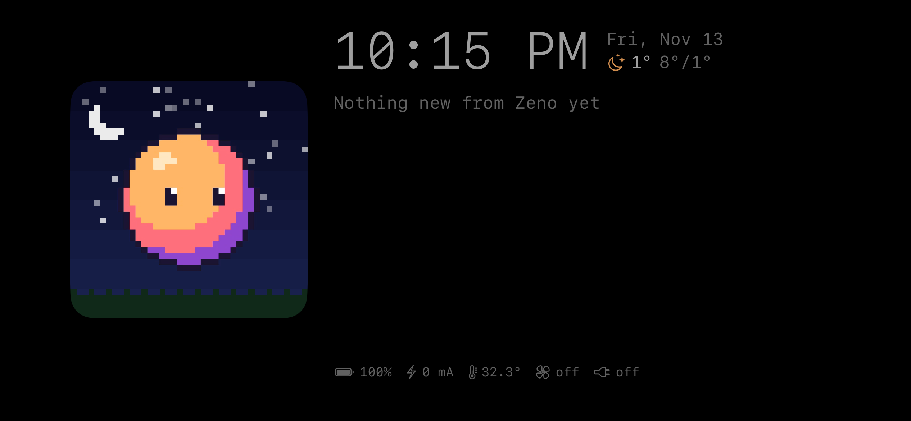
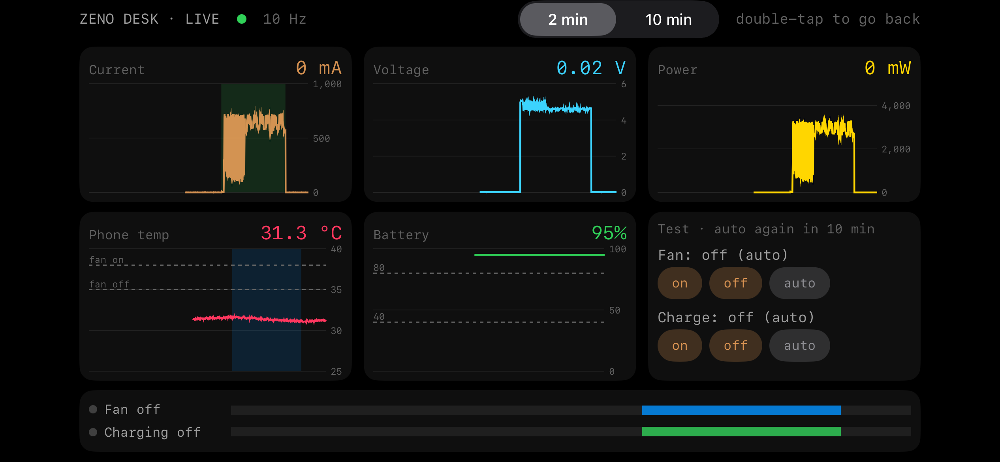

# Zeno Desk

A spare iPhone 12 Pro turned into an always-on desk display for Zeno, my personal AI agent, plus the ESP32 charge
controller that keeps that phone's battery healthy while it never leaves the charger.

## What it does

- **The desk screen** shows pixel Zeno in a small window whose sky follows the real weather, the clock, Zeno's latest
  news, and a live transcript when he's making a phone call.
- **The charge controller** ("black box", an ESP32) switches the phone's USB power through a relay so the battery
  stays between 40% and 80%, measures current and voltage, reads the phone's temperature with an IR sensor, and runs a
  fan. The phone reports its battery level and iOS heat state over Wi-Fi every 60 seconds; if the box hears nothing
  for 15 minutes it turns charging back on.
- **Live graphs:** double-tap the desk screen for 10 Hz graphs of everything the box measures.

## OLED care

Everything drifts a few points every 3 minutes, the graphs screen closes itself after 5 minutes, and from 11pm to
6am the screen goes fully black while Zeno sleeps.

## Layout

| Folder | What |
|---|---|
| [`ios/`](ios/) | The SwiftUI iPhone app (iOS 26) |
| [`firmware/`](firmware/) | The ESP32 charge controller sketch |
| [`PROTOCOL.md`](PROTOCOL.md) | The small HTTP/JSON protocol between the phone, the box and the Pi |
